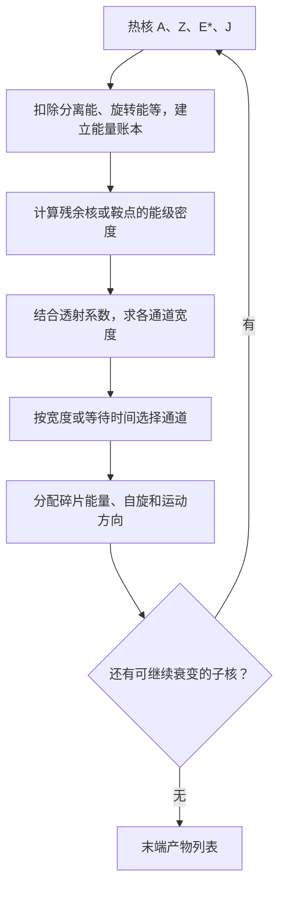

# exfrag 公式精讲：对照 Charity（2008）从物理含义走到代码

这是[工程说明书](exfrag_%E5%B7%A5%E7%A8%8B%E4%BB%A3%E7%A0%81%E8%AF%B4%E6%98%8E%E4%B9%A6.md)的教学补充。建议先读本篇，再回查主说明书中的完整能量项和模块接口；需要动手改变数值时，可打开[交互教学计算器](exfrag_%E5%85%AC%E5%BC%8F%E4%BA%A4%E4%BA%92%E6%95%99%E5%AD%A6.html)。计算器只演示本篇的简化关系，不执行 GEMINI。

主要依据是用户提供的 R. J. Charity，*GEMINI: A Code to Simulate the Decay of a Compound Nucleus by a Series of Binary Decays*，May 2008：[本地文献](C:/Users/Administrator/Zotero/storage/35PNDPRL/gemini.pdf)。附件共12个PDF页，正文印刷页1–10；下文用“印刷页 / PDF页”双定位。例如式（1）在印刷页2 / PDF页4。

附件封面仍有报告编号和副标题的模板占位文字，因此本篇只按实际作者、标题、日期引用，不据占位文字编造报告编号。文献中的公式是研究对象；本次未修改文献、Fortran源码或输入参数。

## 1. 先把整个计算归结为四个问题

一个热核给定质量数 A、电荷 Z、激发能 E*、自旋 J 后，GEMINI反复回答：

1. 发射一个粒子或形成两个碎片后，**能量和角动量是否允许**？
2. 允许的出口有多少可到达的内部状态，即**能级密度有多大**？
3. 这些出口有多容易穿越势垒，即**透射概率和衰变宽度有多大**？
4. 按各出口的权重选择一次衰变，把剩余核继续送入同一流程。

这里“统计”指用可到达状态的数量计算概率，“蒙特卡洛”指按这些概率抽样。一条事件历史不是平均结果；大量事件的频数才趋近模型概率。

**文献的范围从热核已经形成之后开始。** 它不推导本项目的MST并合、波包重叠、Skyrme势及由QMD相空间重建E*的方法。因此主说明书第6节的这些公式仍以anahyp源码为依据，不能把本文献当作它们的直接来源。

## 2. 常见符号：先区分同名而不同义的量

| 符号 | 物理含义 / 单位 | 当前代码中的对应 |
|---|---|---|
| A、Z、N | 核子数、电荷数、中子数；A=Z+N | `A0/Z0`、`para%Acn/Zcn`；主程序`XJR(:,1)=Z`、第二列=N |
| E* | 相对该核基态的总激发能，MeV | `EXCEN`、整数`NEXC`、`Ex0`、`cn%Ex` |
| U | 扣除旋转等有序能量并按模型修正后的热激发能，MeV | `U0/U2/U_saddle`；进入`get_little_a`后还可能被原地改写 |
| E_rot | 固定J的最低旋转能，MeV | `yrast`返回值 |
| ρ(E*,J) | 给定能量、自旋附近的状态密度，通常记MeV⁻¹ | `get_level_density`返回的是经过共同缩放的密度比相关量，不能直接当实验ρ |
| a | 能级密度参数，MeV⁻¹ | `aden`；不是质量数A，也不是加速度 |
| T | 核温度，取k_B=1时以MeV表示 | `temp`；不是E*/A，也不是宏观环境温度 |
| S_CN、S_d、S_i | 文献中母核、子核、发射粒子的自旋，数值以ℏ为单位 | 母核常写`J0/S0`，子核`S2`，粒子`S1` |
| J（文献式1） | 发射粒子的总角动量，即轨道ℓ与本征自旋S_i的耦合 | `l_plus_s`、`l_p_s`；**不是式1中的母核自旋** |
| ℓ | 发射轨道角动量 | `ell`、`ll`等；量子ℓ与几何长度l无关 |
| 𝒮 | 本补充使用的熵符号，以免与自旋S混淆 | `entropy`、母核的`ee` |
| B_i | 发射某粒子的分离能，MeV | `Ba`，质量表差和发射粒子态共同决定 |
| B_f或B_(Z,A) | 指定参考基准上的鞍点能量，MeV | `barrier`、`E_sad`不能互换；有的量已包含旋转基线 |
| ε | 出口相对运动能，MeV | `ek/e_kinetic`；实验室单粒子动能还需反冲分配和boost |
| T_ℓ(ε) | 透射系数，0–1，无量纲 | `get_tl/get_tll`；下标ℓ用于区别温度T |
| Γ_i | 某类衰变的部分宽度，MeV | `gamma(i)`；不是概率，不是γ光子数 |
| τ | 平均寿命；本代码常用zs=10⁻²¹s | `exp_decay`产生随机等待时间，均值约ℏ/Γ |

同一篇文献也复用了字母J：式（1）为发射粒子的总角动量，式（3）的J为所讨论核的自旋。阅读公式时以该式定义为准。

## 3. E*、U和ε：每笔能量只能花一次

### 3.1 热能不是总激发能的别名

文献式（3）下方定义：

\[
U=E^*-E_{\rm rot}(J)+\delta P.
\]

其中δP为作者所用符号约定下的配对回移量。核整体转动已经占用部分激发能，这部分不能再作为任意内部热运动重复计数。配对项则调整连续费米气体近似所用的能量零点，并非凭空创造真实能量。

例如，**教学给定** A=56、E*=50 MeV、E_rot=4 MeV、δP=2 MeV，忽略壳修正：

\[
U=50-4+2=48\ \mathrm{MeV}.
\]

这些E_rot和δP是为解释概念选的数，不是查表算出的某个真实核预测值。若只把50替换为48却忘记它们对应不同参考基准，后续守恒检查仍会出错。

本地`decay_widths`先计算E*减旋转能，再在`get_little_a`中加入配对和壳修正，见[源码:8739](../GEMMOD.f#L8739)、[源码:2873](../GEMMOD.f#L2873)。主程序把实数EXCEN传到GEMINI前转成整数NEXC，并按DECNEXC2裁剪；这是接口处理，文献并没有要求这一量化和裁剪。

### 3.2 发射粒子要付出分离能和相对运动能

以发射到基态的中子为例，在母核静止系、忽略未列出的修正时：

\[
E_p^*=B_n+\epsilon+E_d^*,\qquad
E_d^*=E_p^*-B_n-\epsilon.
\]

B_n对应“把这颗中子从母核分开”的质量差，ε对应母核静止系中中子与剩余核的总相对动能，E_d*是子核还保留的总激发能。

继续使用E_p*=50，教学取B_n=8、ε=5 MeV：子核E_d*=37 MeV。若子核E_rot,d=3、δP_d=1，则其热能为35 MeV。**48、37、35分别是母核热能、子核总激发能、子核热能，不能直接互相替换。**

若发射粒子自身处于激发态，还需支付该激发能；本地可能将它并入`DEF/ex1`及Ba，而不是单独显示在最后一条公式中。[HF质量与能级处理](../GEMMOD.f#L6610)

### 3.3 Coulomb势垒不等于分离能

分离能由核质量差决定；Coulomb势垒限制带电粒子能否离开。HF公式中势垒主要进入T_ℓ(ε)，**不应看到势垒后就在B_i之外再机械地从子核能量扣一次**。本地简化蒸发路径另把超出势垒的动能作为积分变量，才会显式加减势垒；先核对ε的定义，才能比较两条路径。

## 4. 能级密度：为什么指数函数决定了许多结果

### 4.1 ρ是在数“有多少种内部排布”

固定E*和J仍不能唯一确定所有核子的微观状态。ρ(E*,J)dE表示该小能量窗内有多少允许的内部状态。出口能落入的状态越多，统计权重通常越大，但还必须乘透射系数和满足守恒条件。

文献式（3）的主要依赖为：

\[
\rho(E^*,J)\propto(2J+1)\exp\left[2\sqrt{a(U,J)U}\right].
\]

- `2J+1`来自自旋投影的简并数；不能在源码已经计入时再乘一次。
- `aU`无量纲，因此a必须带MeV⁻¹。
- 指数`𝒮≈2√(aU)`是决定性的大项。`∝`只表示主要比例关系，没有给出完整前因子和绝对归一化。

取固定a=7 MeV⁻¹，U从40变50 MeV，只看指数部分：

\[
\frac{\rho(50)}{\rho(40)}\approx
e^{2\sqrt{7\times50}-2\sqrt{7\times40}}=51.94.
\]

能量增加25%，可到达状态数的主要指数因子却增加约52倍。这解释了为什么几MeV的能量零点或势垒差会显著改变计算。它不意味着最终截面也必然增加52倍，因为母核分母和竞争出口同时参与。

### 4.2 a=A/k：不是“a越大温度越高”

当前默认`aden_type=0,aden_0=8`对应：

\[
a=A/8\ \mathrm{MeV}^{-1}.
\]

对教学母核A=56、U=48：a=7，熵𝒮=36.6606。若k从8增到9，a反而变小。

在固定U下，a大意味着热能可分布到更多内部自由度上，熵较大；费米气体近似的温度则较低。不能把“激发态多”和“温度高”当作同一个概念。

### 4.3 T=√(U/a)从哪里来

文献式（11）给出微正则温度：

\[
\frac1T=\frac{\partial\ln\rho}{\partial U}.
\]

固定J，暂忽略缓变前因子，并假设a与U无关，则：

\[
\ln\rho\simeq2\sqrt{aU},\quad
\frac1T\simeq\sqrt{a/U},\quad T\simeq\sqrt{U/a}.
\]

所以教学例子的T=√(48/7)=2.6186 MeV，而E*/A=50/56=0.8929 MeV/u。二者不同。

**如果a本身随U改变**，只对主指数求导也应得到：

\[
T_{\rm derivative}=\frac{\sqrt{a(U)U}}{a(U)+U\,da/dU}.
\]

实际ρ前因子的导数还会继续修正它。本地多处仍使用`temp=sqrt(U/aden)`，因此应称为该实现的局部温度近似，不能声称它对所有22种aden_type都等于文献式（11）的严格导数。

### 4.4 为什么代码没有直接计算e的几十次方再相除

本地令母核熵`ee=𝒮_p`，把共有的大指数提出来。简记缓变部分为C：

\[
\rho_p=C_p e^{\mathcal S_p},\quad
\rho_d=C_d e^{\mathcal S_d},\quad
\frac{\rho_d}{2\pi\rho_p}
=\frac{C_d}{2\pi C_p}e^{\mathcal S_d-\mathcal S_p}.
\]

代码先用`pe=1,ee=entropy0`计算母核C_p，再令`pe≈2πC_p`，随后子核`get_level_density`直接返回右侧的缩放量。`pe`与`ee`一起实现母核分母，不是两个新的物理参数。[缩放准备](../GEMMOD.f#L8758)｜[密度函数](../GEMMOD.f#L4034)

因此在`gam_jj=level_density*de*sum_tl`外面再除一次`2πρ_p`会重复归一化。主说明书给出的`1+U^1.25*(sigma²)^1.5`等前因子属于当前实现细节，不能由文献式（3）的比例式单独推出来。

## 5. 壳修正：为什么“衰减函数”最后趋近1

文献式（4）写作：

\[
a_{\rm eff}(U)=\widetilde a(U)
\left[1+\frac{\delta W}{U}h(U)\right].
\]

δW是相对于光滑质量基准的壳修正，可正可负；ã是光滑背景的能级密度参数。**衰减的是相对项δW h(U)/U，不是一定要求h(U)本身减小。**

### 5.1 附件式（5）有需要明确标出的符号问题

附件印刷页3 / PDF页5实际显示`h(U)=1−exp(η₁U)`，而紧接着给正的尺度`1/η₁=18.5 MeV`。若照此用正指数，高能下不会衰减。这里不能不作说明就照抄为程序公式。

与“fadeout”含义、低高能极限及本地源码负指数一致的解释是：

\[
h(U)=1-e^{-U/E_d},\qquad E_d\simeq18.5\ \mathrm{MeV}.
\]

这是根据数学一致性和当前源码提出的**疑似排印符号修正**，不是声称已找到作者勘误。下文教学计算使用该负指数解释；本地源码常量为18.52 MeV。

U→0时`h(U)/U→1/E_d`，没有真正的1/U发散；U→∞时h→1、δW h/U→0，才恢复光滑背景。

教学取A=100、ã=12.5 MeV⁻¹、δW=−5 MeV，用E_d=18.52：

| U / MeV | h(U) | h(U)/U / MeV⁻¹ | a_eff / MeV⁻¹ |
|---:|---:|---:|---:|
| 2 | 0.10236 | 0.05118 | 9.3011 |
| 20 | 0.66038 | 0.03302 | 10.4363 |
| 100 | 0.99548 | 0.00995 | 11.8778 |

h虽然增加，a_eff却逐渐返回12.5。这张表中的核与壳修正是教学设定，非质量表预测。

### 5.2 为什么源码把壳项加进U，而文献把它写进a

暂把ã视为常数并使用相同h(U)：

\[
a_{\rm eff}U=\widetilde a[U+\delta W h(U)].
\]

所以主指数`2√(a_eff U)`可等价写为`2√(ã U_eff)`，其中`U_eff=U+δW h(U)`。这是理解两种写法的关键。

本地实际更具体：先`U←U+pair_energy`，在`mass_option=2`时执行：

\[
U\leftarrow U+shell\_corr
\left[1-\exp\left(-\frac{U+E_{rot}}{18.52}\right)\right].
\]

然后用修改后的U计算aden和entropy。因此，与文献仍有三处区别：指数自变量含E_rot；部分aden模式也随修改后的U变化；密度前因子同样使用新U。上述等价推导**只说明主指数的重写思路，不证明两个实现逐数相同**。切勿在调用`get_little_a`之前又手工做同一壳修正。

## 6. Hauser–Feshbach式（1）：把每层求和拆开看

来源：印刷页2 / PDF页4。为避免J混淆，这里把原文式（1）的发射粒子总角动量改写为j：

\[
\Gamma_i^{HF}=\frac1{2\pi\rho_p(E_p^*,J_p)}
\int d\epsilon\sum_{J_d}
\sum_{j=|J_p-J_d|}^{J_p+J_d}
\sum_{\ell=|j-s_i|}^{j+s_i}
T_{i\ell}(\epsilon)\,
\rho_d(E_p^*-B_i-\epsilon,J_d).
\]

实际求和还受允许的整数/半整数角动量、能量条件和模型通道限制。这是统计复合核近似，不描述核子在输运阶段经历的每一次碰撞。

### 6.1 每一块的作用

| 公式部分 | 直观解释 | 代码落实 |
|---|---|---|
| `ρ_d(E*−B−ε,J_d)` | 这次发射后，剩余核能落入多少内部态 | `Ba`，`yrast`，`get_little_a`，`get_level_density` |
| `T_iℓ(ε)` | 出口能否穿过Coulomb/离心等势垒 | `prepare_tl → get_tl` |
| `ΣJ_d` | 遍历剩余核可能的自旋 | `s2_loop` |
| `Σj,Σℓ` | 枚举能拼回母核角动量的向量组合 | `l_plus_s_min/max`与`ell_loop` |
| `∫dε` | 粒子能带走不同动能，将所有允许动能出口相加 | `ek_loop`，离散步长`de` |
| `1/(2πρ_p)` | 母核态密度归一化，给出“每个母态”的平均宽度 | `pe/ee`共同实现 |

不是“每多一个Σ就再乘一个简并数”。例如程序已经显式耦合s_i时，再统一乘`2s_i+1`可能重复计数。

### 6.2 角动量上下限来自三角形

两次向量耦合为：

\[
\mathbf j=\boldsymbol\ell+\mathbf s_i,\qquad
\mathbf J_p=\mathbf J_d+\mathbf j.
\]

向量长度必须满足三角不等式，因而得到式中上下限。教学取J_p=0，发射中子s_i=1/2，选子核J_d=1/2，则j只能为1/2，ℓ候选为0或1；额外选择规则还可能进一步限制。母核自旋较高时，允许组合通常更多，离心势垒和剩余旋转热能也随之改变。

这解释了HF比不显式处理这些耦合的近似更费时，也解释了输入J错误为什么不仅影响角度，还会改变宽度与粒子谱。[s2_loop](../GEMMOD.f#L6834)

### 6.3 Tℓ决定低能入口，ρ_d抑制高能出口

ε小时，带电粒子可能很难穿透势垒，Tℓ很小；ε大时，带走太多能量，子核可用热能下降、ρ_d迅速减小。两者竞争往往形成能谱峰。

**中子的Coulomb势垒为0，不等于所有ℓ的Tℓ都为1**：离心势垒和核势依然存在。本地Tℓ由预计算表及插值产生，不是每个事件重新解光学势方程。

继续第3节教学例子：母核a_p=7、U_p=48，子核A_d=55、a_d=55/8、U_d=35。只保留熵指数：

\[
e^{\mathcal S_d-\mathcal S_p}
=e^{31.0242-36.6606}=0.003566.
\]

这是密度比的**指数部分**，不是发射中子的概率，更不是整条中子通道宽度。还缺自旋前因子、Tℓ、积分和其余组合。

### 6.4 手算一个离散积分

以下用纯教学数值，假定只留一个角动量组合、三个宽1 MeV的能格；第二列是未含`1/(2π)`的完整密度比：

| 能格 | ρ_d/ρ_p | Tℓ | 两者乘积 |
|---|---:|---:|---:|
| 1 | 0.050 | 0.20 | 0.0100 |
| 2 | 0.020 | 0.80 | 0.0160 |
| 3 | 0.006 | 0.95 | 0.0057 |

于是`Γ≈(0.0100+0.0160+0.0057)×1/(2π)=0.005045 MeV`。这就是`ek_loop`里一小块`de×density×sum_tl`的意义。源码中的density已含缩放分母，因此写实现时不能再加本例显式的1/(2π)。

## 7. 从Γ得到事件：概率与寿命是两种不同的量

假设一次宽度计算得到教学数值：Γ_n=0.8、Γ_p=0.15、Γ_γ=0.05 MeV。则Γ_tot=1 MeV，无延迟、无额外偏置时：

\[
P_n=0.8,\quad P_p=0.15,\quad P_\gamma=0.05.
\]

均匀随机数r=0.90落在累计区间[0.80,0.95)，所以这次选质子。下一次仍可能选中子；不能把一次抽样理解为产生0.8个中子。

寿命来自指数生存律：

\[
P(t_{decay}>t)=e^{-\Gamma_{tot}t/\hbar},\quad
\overline\tau=\hbar/\Gamma_{tot},\quad
t=-\frac{\hbar}{\Gamma_{tot}}\ln r.
\]

代码`exp_decay`使用`ℏ≈0.65824 MeV·zs`，故总宽度1 MeV时平均寿命0.65824 zs。**如果所有通道宽度一起乘2，分支概率不变，平均寿命减半。** 这也说明仅看产额有时无法辨认时间尺度。

有裂变延迟时，不一定可直接用上述静态Γ比：本地可能给不同通道抽等待时间并加延迟，取最早者。`t_delay`不能只理解为最后在输出时间加一个常数。[等待时间](../GEMMOD.f#L2700)｜[竞争逻辑](../GEMMOD.f#L8207)

每一步发射后A、Z、E*、J改变，下一步必须重算宽度。初次P_n=0.8也不意味着整个级联一直使用0.8。

## 8. 裂变式（8）：先明确“势垒”的零点

来源：印刷页4 / PDF页6。文献的Bohr–Wheeler形式为：

\[
\Gamma_f=\frac1{2\pi\rho_p(E^*,J_p)}
\int_0^{E^*-B_f}d\epsilon\,
\rho_{sad}(E^*-B_f-\epsilon).
\]

鞍点可理解为从紧致母核走向分裂构型必须越过的高处；越过之后还要继续走到颈部断开的断裂点。文献这里的B_f(J)包含随自旋变化的鞍点能量基准，即“相对于旋转基态的势垒高度+旋转基线”，不应再减一次同样的旋转能。

对比HF：两者都在数出口态。HF还要乘一个粒子穿透系数；过渡态方法在其所采用的越垒/无再穿越近似下直接计数鞍点可向外流出的状态，不再机械地附加同一个粒子Tℓ。

### 8.1 为什么宽度常近似为T_s ρ_s/(2πρ_p)

文献式（10）、（11）来自对`lnρ`在小能量损失ε处的一阶展开：

\[
\ln\rho(U_s-\epsilon)\simeq\ln\rho(U_s)-\epsilon/T_s,
\quad \rho(U_s-\epsilon)\simeq\rho(U_s)e^{-\epsilon/T_s}.
\]

若温度变化不大、积分上限相对T_s足够大：

\[
\int_0^{U_s}\rho(U_s-\epsilon)d\epsilon
\simeq\rho(U_s)T_s(1-e^{-U_s/T_s})
\simeq T_s\rho(U_s).
\]

这就是本地`complex_frag`中宽度前面乘`temp`的来源。靠近阈值U_s很小时，不能把最后一步当严格等式。`fission_width`则以约0.5 MeV步长做显式积分，并含本地其它修正。[complex_frag](../GEMMOD.f#L9165)｜[fission_width](../GEMMOD.f#L9320)

### 8.2 为什么提高势垒2 MeV会有明显影响

保持其它量近似不变、鞍点温度为2 MeV时，势垒提高ΔB=2 MeV使可用鞍点热能少2 MeV：

\[
\frac{\Gamma_f(B+\Delta B)}{\Gamma_f(B)}\simeq e^{-\Delta B/T_s}=e^{-1}=0.3679.
\]

这解释了势垒参数的高敏感性。但若a、J或所有通道同时变化，不能直接用此局部估计代替整条级联。

## 9. Moretto式（9）–（17）：为何要分别枚举Z和A

### 9.1 在“在哪里断开”这一方向增加自由度

对称裂变只讨论接近一分为二；IMF或不对称裂变需要沿质量不对称坐标y寻找**条件鞍点**：在强制固定这一分裂比例时，其它形变坐标上的鞍点。

文献式（9）额外引入y、共轭动量p_y、惯量m_y，积分中的可用能量包含：

\[
E^*-B(y,J_p)-\frac{p_y^2}{2m_y}-\epsilon.
\]

用前节指数近似对p_y积分：

\[
\int_{-\infty}^{\infty}\frac{dp_y}{h}
e^{-p_y^2/(2m_yT)}=\frac{\sqrt{2\pi m_yT}}h.
\]

这得到文献式（12）。因而该根号项代表额外集体自由度的状态数，不能凭名称把它当作发射粒子质量或任意拟合因子。

后来采用离散Z出口的式（13）去掉这一连续惯量因子；GEMINI再扩成离散(Z,A)通道，即式（14）：

\[
\Gamma_{Z_1,A_1}=\frac1{2\pi\rho_p}
\int d\epsilon\,
\rho_{sad}[E^*-B_{Z_1,A_1}(J_p)-\epsilon].
\]

**从连续y式到离散(Z,A)式包含模型处方的变化，不是只把积分号替换为求和号。** 当前代码用`imf/complex_frag`枚举离散出口，不需要用户再额外输入一个m_y。

### 9.2 同一质量分裂，还可以有不同电荷分配

文献式（15）可写为：

\[
B_{Z_1,A_1}=B^{Sierk}_{A_1}
+\Delta M+\Delta E_C-\delta W_p-\delta P_p.
\]

Sierk参考分裂的两个碎片使用与母核相同的Z/A，但实际Z_1必须取允许的整数。固定A_1、A_2时，定义参考电荷`Z_1^0=Z_p A_1/A_p`、`Z_2^0=Z_p A_2/A_p`，文献式（16）、（17）就是：

\[
\Delta M=[M(Z_1,A_1)+M(Z_2,A_2)]
-[M(Z_1^0,A_1)+M(Z_2^0,A_2)],
\]

\[
\Delta E_C=E_C(Z_1,A_1;Z_2,A_2)
-E_C(Z_1^0,A_1;Z_2^0,A_2).
\]

例如母核(Z,A)=(40,100)，设A_1=30、A_2=70，参考电荷是12和28。若试11和29，质量数仍守恒、电荷总和仍为40，但内部质量与Coulomb能改变，这就改变该出口宽度。这里M是光滑模型质量，不把带强壳效应的实验质量再重复加一遍。

两球近似的Coulomb能：

\[
E_C\simeq\frac{1.44Z_1Z_2}
 {r_0A_1^{1/3}+r_0A_2^{1/3}+d}\ \mathrm{MeV}.
\]

文献该段取r_0=1.225 fm、d=2 fm。本地`saddle`实际引用`gem_kind`中的r0=1.16 fm、sep=2 fm；同模块另有r0ld=1.2249，但此处R1/R2使用的是r0。这是具体数值差别。本地还使用预先减去基准质量/Coulomb项的`sad_array`，再加回当前分裂的模型质量与Coulomb能，不能把`E_bar`再加一次ΔM和ΔE_C。[saddle](../GEMMOD.f#L4662)｜[常量定义](../GEMMOD.f#L45)

式（15）的负壳/配对项与代码向`U_saddle`加入母核修正是同一参考基准转换的两种书写方向：势垒减去δ，则E*减势垒时相当于加回δ。但还应核对每个模块具体如何定义δ，不能只按变量名判断。

### 9.3 为什么文献说重核的质量分布可能太宽

附件引言与印刷页5指出：轻系统的鞍点和断裂点比较接近，鞍点的质量分配可能接近最终分配；重系统两者相距较远，后续形变演化还能重塑质量分布。因此旧GEMINI的条件鞍点处方在重系统中可能给出过宽分布。

这属于模型适用性，不一定能靠改一个a_scale修好。文献为GEMINI++讨论了不同的重核对称裂变处理及经验质量宽度；当前Fortran文件不能因名字叫GEMINI就被视为已经包含全部++改动。

## 10. 两个碎片怎样分热能：式（22）不是强制平分

来源：印刷页6 / PDF页8。设已经扣除其它模式能量后，有U_tot可供两个碎片分配：

\[
P(U_1)\propto\rho_1(U_1)\rho_2(U_{tot}-U_1)
\simeq e^{2\sqrt{a_1U_1}+2\sqrt{a_2(U_{tot}-U_1)}}.
\]

为什么是乘积？若碎片1有n_1种状态、碎片2有n_2种状态，在固定总能量且近似独立时，组合总数就是n_1n_2。

为求最可能分配，对对数概率求导：

\[
\frac{d\ln P}{dU_1}=\sqrt{a_1/U_1}
-\sqrt{a_2/(U_{tot}-U_1)}=0.
\]

所以：

\[
\frac{U_1}{U_2}=\frac{a_1}{a_2},\qquad
T_1=T_2,\qquad
U_{1,peak}=U_{tot}\frac{a_1}{a_1+a_2}.
\]

教学取a_1=8、a_2=12 MeV⁻¹，U_tot=60 MeV：最可能为24和36 MeV，两边温度都是√3=1.732 MeV。若a与A成正比，就近似按质量比例分热能。30/30也允许，只是相对于峰值的概率密度约为0.7041。

这是**概率密度的峰值**，不是每一次事件都必须等于的固定值，也不保证有限边界下均值精确相同。两次不同随机数会选到不同U_1。

在峰附近把logP展开到二阶，可以得到近似方差：

\[
\sigma_{U_1}^2\simeq
\frac{2T^3a_1a_2}{a_1+a_2}.
\]

这解释了本地`sphere_imf`中的`sig=sqrt(2*temp**3*aden1*aden2/aden)`。但代码还有集体模式能量扣除、有限采样区间、额外能量近似及最后加回碎片旋转能，不能直接把daughter%Ex当作本段的U_1。[实际采样段](../GEMMOD.f#L4982)

## 11. γ公式（23）：为什么粒子蒸发最后会停下来

粒子发射需要支付分离能；当剩余激发能不足，粒子宽度会很小或为零。γ发射不改变A和Z，可以用电磁跃迁继续带走较小能量和角动量，因此能决定粒子级联的结束。

将文献式（23）按“常系数×能量积分”重写，令多极阶数λ=1或2：

\[
\Gamma_{E\lambda}=F_\lambda C_\lambda(A)
\sum_{J_d=|J_p-\lambda|}^{J_p+\lambda}
\int dE_\gamma\, E_\gamma^{2\lambda+1}
\frac{\rho_d(E^*-E_\gamma,J_d)}{\rho_p(E^*,J_p)},
\]

\[
C_\lambda(A)=\frac{18(\lambda+1)}
 {\lambda(\lambda+3)^2[(2\lambda+1)!!]^2}
\frac{e^2}{\hbar c}\left(\frac R{\hbar c}\right)^{2\lambda}
\frac1{D_0},\quad R=1.2A^{1/3}\ \mathrm{fm},\ D_0=1\ \mathrm{MeV}.
\]

`!!`为双阶乘，3!!=3×1，5!!=5×3×1。E1是电偶极、E2是电四极，**不表示光子能量为1或2 MeV**。两者能量权重分别是E_γ³和E_γ⁵，但系数、选择的子核自旋和密度不同，不能仅看幂数比较总宽度。

用局部恒温近似密度比`∝exp(−E_γ/T)`，谱形主要为`E_γ^(2λ+1) exp(−E_γ/T)`，不考虑边界时峰约在`E_γ=(2λ+1)T`。当可用激发能有限、a变化或离散能级占主导时，这个教学峰位估计会失效。

本地`gamma_ray`令`const=2π A^(2λ/3) wue(λ) strength(λ)`，再乘已经含1/(2πρ_p)的缩放密度。与前面HF相同，要整体看归一化。[gamma_ray](../GEMMOD.f#L8919)

**文献数值与当前输入不同：** 文献取F_1=0.025、F_2=9.0；本地样例E1_strength=0.1、E2_strength=50。虽然均为对Weisskopf估计的强度修正，移植前仍需核对全部常系数和密度口径，不能声称当前输入复现文献默认。源码还把非正强度重置为0.1/50，所以填0不能关闭γ。

本地在γ宽度占绝大部分时会终止显式粒子级联并存放剩余激发信息；因此它不是完整追踪所有低能γ谱线的专用能谱程序。

## 12. 文献中的GEMINI++改动：哪些只是解释参考

### 12.1 式（2）：热涨落下的三组势垒平均

文献为GEMINI++提出：

\[
\overline T_\ell(\epsilon)=\frac13
\left[T_\ell^{R_0-\Delta r}(\epsilon)+T_\ell^{R_0}(\epsilon)
+T_\ell^{R_0+\Delta r}(\epsilon)\right].
\]

三个不同势半径代表势垒的分布。在低于平均势垒的区域，较低势垒那一部分仍可放出粒子，因而能增加低能α等产额。**平均透射概率通常不等于先平均半径再求一个透射概率**，因为T对势垒是非线性的。

文献用Δr=w√T，并按MeV数值代入温度给w=0.9 fm的经验写法。量纲明确时可写成`Δr=(0.9 fm)√[T/(1 MeV)]`。这不是本地输入文件里一个隐藏的w参数；当前Fortran默认调用`ratio=-1`，用其自己的半径膨胀/形变表处理，不能直接等同式（2）。

### 12.2 式（6）、（7）：a随激发能变化

式（6）的结构是：

\[
\widetilde a(U)=\frac A{k+\kappa U/A}.
\]

它可看作对常数k的能量依赖修正。本地`aden_type=-9/-10/-11`有类似分母，分别固定常数项8/7/6，并令aden_0充当能量项系数；默认mode0却是常数A/aden_0。若使用严格物理量单位，上式k带MeV、κ无量纲；文献经验参数的附注单位采用数值代入习惯，使用带单位软件时应先改写为明确的能量比。

式（7）是文献为GEMINI++系统化的新形式：

\[
\widetilde a(U)=
\frac A{k_\infty-(k_\infty-k_0)
\exp[-\frac{\kappa}{k_\infty-k_0}\frac UA]},
\]

其中k_0=7.3 MeV、k_∞=12 MeV、文献经验数值κ=0.00493 exp(0.0332A)。低能时`exp(−x)≈1−x`，分母退化为`k_0+κU/A`；高能时趋于k_∞，因此a趋于A/12。

教学代入U/A=3 MeV：A=100时ã/A≈0.13001 MeV⁻¹，A=200时约0.08638 MeV⁻¹，体现了文献参数化的强质量依赖。**当前22个aden_type中没有完整的这一指数饱和形式；不能把aden_0改成7.3就声称实现了式（7）。**

### 12.3 式（18）–（21）与重核鞍点到断裂点

文献对GEMINI++重系统近对称裂变使用Bohr–Wheeler总宽度，并讨论整体乘2.4、a_f/a_n=1的拟合组合。该数值依赖当时的整套能级密度与势垒模型，不是当前Fortran的通用Kramer默认值。

文献还用`t=η(B_sad−B_sciss)`估计鞍点至断裂点的时间，并讨论在断裂构型上的Weisskopf–Ewing蒸发。式（20）的关系是：

\[
\sigma_{inv}(\epsilon)=\frac{\pi\hbar^2}{2\mu\epsilon}
\sum_\ell(2\ell+1)T_\ell(\epsilon).
\]

意思是用逆俘获反应的有效面积，把轨道分波汇总为不显式逐个耦合核自旋的蒸发表达式。代入式（19）可见它仍然是“出口密度×透射权重/母核密度”。附件式（19）以断裂构型的能量符号压缩书写；若用于普通粒子发射，必须重新明确分离能和母子质量零点，不能因式中没显式写B_i就把分离能丢掉。

式（21）`ρ_sciss∝exp[2√(a(E*−B_sciss))]`强调热能仍要扣除该形变构型的基线。此处a=A/8及η=2 zs/MeV是文献该阶段的处方；**当前t_delay不是这一η，当前简化evap分支也不能自动视为这套++鞍点至断裂点模块。**

## 13. 文献式号 → 学习问题 → 本地代码

| 文献式号 | 印刷页 / PDF页 | 要理解的问题 | 当前源码关系 |
|---|---|---|---|
| 1 | 2 /4 | 怎样把粒子出口、能量和角动量相加为宽度 | Hauser_Feshbach、s2_loop、ek_loop、ell_loop；有低Z回退和积分截断 |
| 2 | 2 /4 | 势垒分布为什么改变低能谱 | 文献明确描述++方案；本地形变/膨胀表不等价 |
| 3 | 2 /4 | 状态数为何指数增长，U如何定义 | get_little_a、get_level_density；本地还有前因子 |
| 4–5 | 3 /5 | 壳效应怎样消失 | get_little_a中负指数修正；附件式5正号为疑似排印问题 |
| 6 | 3 /5 | a如何随U变化 | −9/−10/−11模式结构近似对应，默认0不对应 |
| 7 | 3 /5 | 高能下a为何趋于有限值 | ++饱和参数化，本地无完整对应模式 |
| 8 | 4 /6 | 对称裂变如何计数鞍点态 | fission_width；还含本地修正 |
| 9、12 | 4 /6 | 连续质量不对称自由度如何积分 | 理论背景；不是当前需要另输入m_y的调用接口 |
| 10–11 | 4 /6 | 指数近似和温度如何推出来 | complex_frag的Tρ近似；sqrt(U/a)的适用条件需注意 |
| 13–14 | 4 /6 | 为何枚举离散Z及A出口 | imf、complex_frag |
| 15 | 4 /6 | 条件鞍点怎样修正零点 | sadfit、saddle、complex_frag |
| 16–17 | 5 /7 | 电荷不对称的质量/Coulomb修正 | sad_array的基准扣除与当前质量加回 |
| 18 | 5 /7 | 母核壳/配对怎样修正裂变势垒 | 本地fission_width有相应零点处理；文献++整体拟合不能直接移植 |
| 19–21 | 6 /8 | 断裂构型的WE蒸发与热能 | ++特定阶段的处方；本地evap只是概念相关 |
| 22 | 6 /8 | 两碎片为何按态数随机分热能 | sphere_imf中的接受/拒绝采样，另有模式扣能 |
| 23 | 6 /8 | E1/E2怎样结束粒子级联 | gamma_ray，当前强度数值与文献不同 |

## 14. 阅读代码时的六个自检问题

1. **当前能量是哪一本账？** 是实验室动能、总激发能、已扣旋转的U，还是鞍点参考下的热能？
2. **当前ρ是什么？** 是原始密度，还是已含母核分母和熵差的缩放量？
3. **这里的J是谁的自旋？** 母核、剩余核、发射粒子的总角动量，还是某液滴公式中的同名字常数？
4. **这个积分变量带走什么能量？** 是否已经包含Coulomb、离心势垒和反冲？
5. **参数是否被当前分支使用？** 默认imf_option=2不把a_scale/b_scale当作全局乘子；文献++参数不是本地自动默认。
6. **这一步是确定性计算还是概率抽样？** 宽度由模型积分产生，实际事件还要随机选择；单事件与平均谱不等价。

这些问题能帮助解释参数变化的方向，但不能取代守恒、数值收敛及物理基准验证。已有源码问题仍见[验证附录](exfrag_%E9%AA%8C%E8%AF%81%E4%B8%8E%E5%B7%B2%E7%9F%A5%E9%97%AE%E9%A2%98.md)。本篇所有“教学给定”的数值均用于说明公式，没有冒充真实事件或拟合结果。

## 15. 本次补充的核对范围

已提取并阅读12页附件，逐页渲染核对含公式的PDF页4–8，并放大页8核对式（23）的前因子。正文页1、7及参考文献页用于上下文定位，未将参考文献表中的论文视为已阅读全文。

附件SHA-256：`D3978C9A926D8725F46B9257F396BCA557B268345722CD3D8529FBF15960CCC7`。本次的公式解释结合该附件与本地代码，不依赖其它GEMINI版本的推测。主文说明、此处的教学推导、文献原式和源码实现差异已经分别标明。
